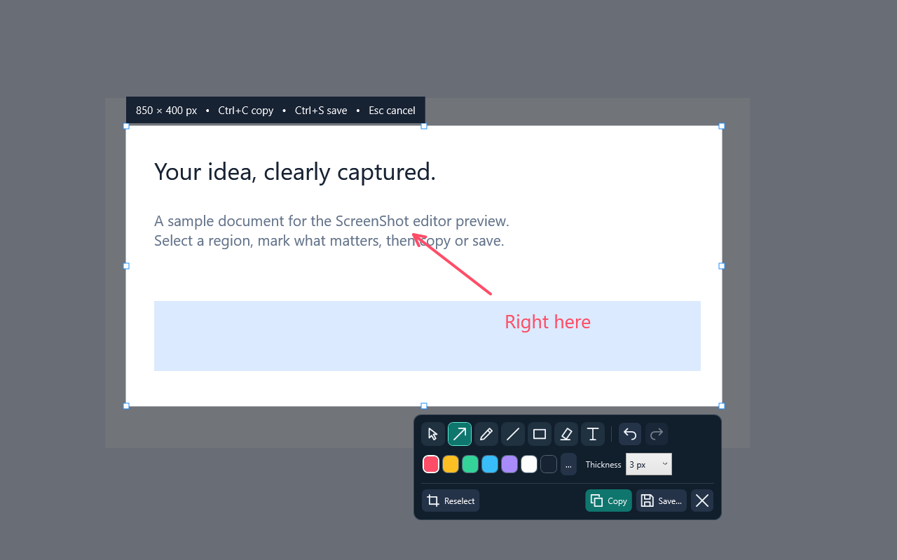

# ScreenShot

A small, local-first screenshot and annotation app for Windows, inspired by Lightshot's quick capture workflow. No account, uploads, telemetry, or screenshot server.

**v0.3.5 — UX preview.** Windows x64. The portable build includes .NET; extract the ZIP and run `ScreenShot.exe`.



## Capture and annotate

1. Start ScreenShot. Press **Print Screen** or click **Capture screenshot**.
2. Drag over the area to capture. Resize its edges/corners as needed.
3. Use **Arrow**, **Pen**, **Line**, **Box**, **Highlight**, or **Text**.
4. **Ctrl+C** copies the annotated image; **Ctrl+S** saves PNG, JPEG or PDF. **Esc** cancels.

The **Move** tool selects existing annotations. Drag to move them, **Delete** to remove, or double-click text / press **F2** to edit it. Drag an empty part of the selection with Move to reposition the crop. Color and width controls apply to the selected annotation, or to future marks. Text wraps; **Enter** or **Apply** commits it, **Shift+Enter** adds a new line, and **Esc** or **Cancel** discards the edit. **Ctrl+S** applies active text before saving. **Ctrl+Z** undoes, **Ctrl+Y** or **Ctrl+Shift+Z** redoes. **Ctrl+A** selects the full virtual desktop. Reselect changes the crop without deleting annotations.

Click the shortcut on the home screen to assign a new key combination. Single keys (including letters, numbers, function keys and Scroll Lock) and key combinations are accepted. Single-key shortcuts also capture while typing in other apps; a dedicated mouse-mapped key such as Scroll Lock avoids that. Re-recording the current shortcut confirms it without starting a capture. Esc cancels and Tab navigates the recorder. Raw mouse-button binding is not implemented; DPI-only buttons must emit a supported keyboard key through their mouse software. If Print Screen is occupied, the app tries **Ctrl+Shift+S** and reports the fallback; you can choose another shortcut. It does not change Windows settings. Closing the home window leaves the tray icon running; **tray → Exit** quits. The app does not add itself to Windows startup automatically. Launch `ScreenShot.exe --background` to start in the notification area without opening the home window; a shortcut with this argument can be placed in the Windows Startup folder. A second background launch leaves the running app undisturbed.

Settings: `%LOCALAPPDATA%\ScreenShot\settings.json`. Bounded local capture diagnostics: `%LOCALAPPDATA%\ScreenShot\capture.log` (timings and errors, no image content). Screenshots are written only when you choose Save or Copy.

## Build

Install the **.NET 10 SDK** on Windows. Then:

```powershell
./scripts/build.ps1             # release build + core and WPF rendering tests
./scripts/build.ps1 -Publish    # also creates artifacts/ScreenShot-0.3.5-win-x64.zip
dotnet run --project src/ScreenShot
```

The projects have no third-party runtime packages. WPF handles UI/drawing, Win32 handles global shortcuts and desktop positioning, and Windows Forms supplies the tray icon and color picker.

Optional Windows integration/preview check:

```powershell
dotnet run --project tests/ScreenShot.IntegrationTests -- --window-smoke --previews
```

This briefly opens a synthetic overlay and verifies its physical HWND bounds. Preview images use synthetic content, not a real desktop screenshot.

## Current validation and limits

Automated coverage includes reversed/clamped selections, small selections, movement, immutable undo/redo history, independent style changes, capture-loss cancellation, text wrapping (including unbroken URLs), all tool rendering, crop pixel/dimension checks, and PNG/JPEG round trips. A real HWND positioning smoke check passed on the development machine; the app launched and exposed its dashboard controls.

Live desktop testing verified area selection, arrow and text annotation, undo/redo, and PNG export on the capture-fix build. The 0.3.2 installed build passed live shortcut recording checks: standalone A, re-recording the existing A binding without capture, then switching to Scroll Lock. Clipboard acceptance and physical Print Screen forwarding over RDP remain open. For 0.3.3, contextual controls and selection semantics passed regression checks; rendered normal/small/recording layouts were inspected and installed dashboard controls were read back. The final capture input retry was blocked by Windows input access. Actual multi-monitor mixed-DPI operation, clipboard contention, and HDR hardware have **not** been manually qualified. The current capture backend is SDR GDI; protected/video surfaces and secure desktops may appear black or fail. The overlay cancels if the display configuration changes. This first build is unsigned.

The compact editor shows contextual Thickness or Font size (in pixels), hides unused controls for Move/Highlight, and separates editing from Copy/Save. Tool and color selection states are exposed to assistive technology. The home screen has a compact shortcut row with Change; typing warnings only appear after assigning an unmodified letter or number. The editor has vector icons, quick color swatches and tool keys: **V** Move, **A** Arrow, **P** Pen, **L** Line, **R** Box, **H** Highlight, **T** Text. Reopening the executable brings the running app forward instead of creating another instance.

Screenshots are never uploaded. Link sharing, OCR, scrolling capture, recording, and cloud history are outside this version's scope.

PDF export saves the annotated crop as one borderless page, preserving its aspect ratio and original pixels with lossless compression. Choose **PDF document** in the Save dialog. No PDF printer is required.
